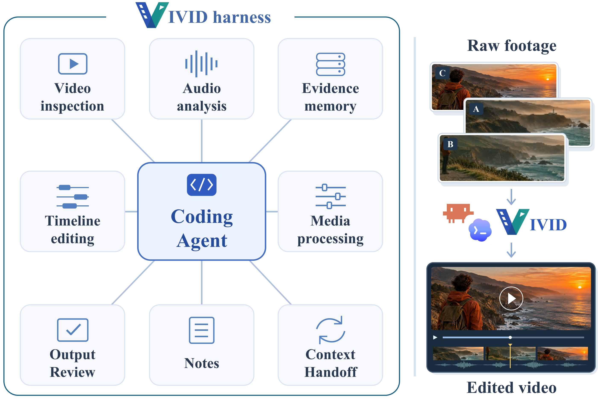
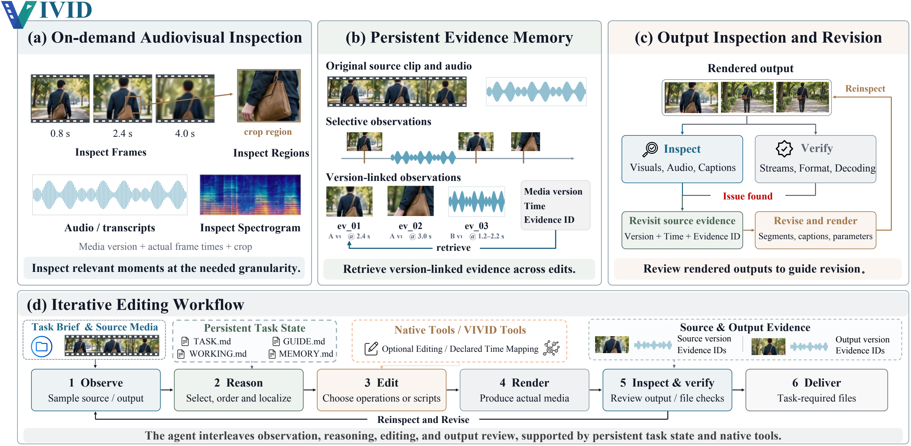
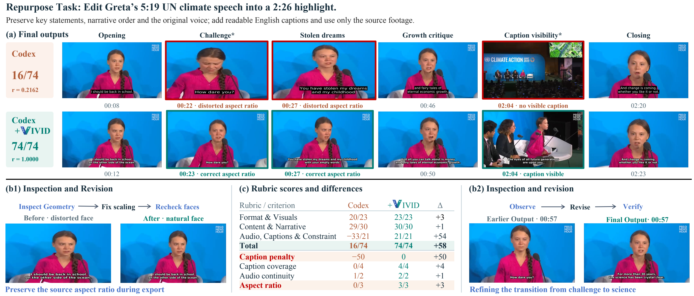
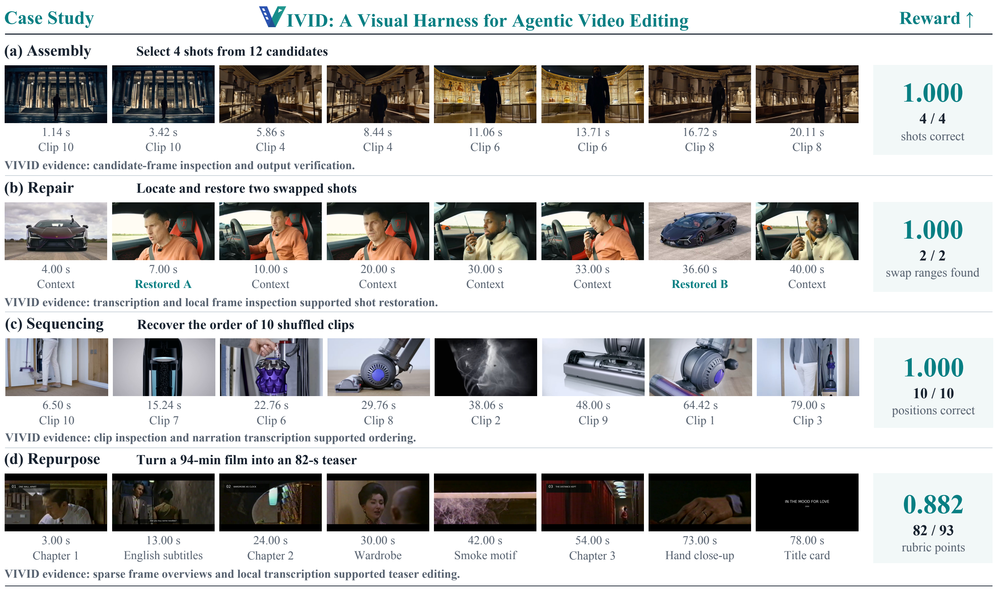

# VIVID: A Visual Harness for Agentic Video Editing

[Paper PDF](assets/paper/VIVID.pdf)

VIVID equips coding agents such as Codex, Claude Code, and OpenCode for video editing without additional model training. Agents use their own shell and programming tools to decide how to inspect footage, edit videos, and review the final output.

[](assets/figures/teaser.pdf)

[How VIVID works](#how-vivid-works) · [Results](#results) · [Install the skill](#install-the-vivid-skill) · [Install from source](#install-from-source) · [Usage](#usage) · [Repository structure](#repository-structure) · [Benchmark evaluation](#evaluation-on-agenticvbench)

## How VIVID works

VIVID supports video editing through three core components:

- **On-demand audiovisual inspection:** Video overviews, local frame views, audio analysis, and transcription help agents understand footage and locate relevant segments.
- **Persistent evidence memory and retrieval:** Observations are stored with their media versions, timestamps, and evidence IDs for later retrieval.
- **Output inspection and revision:** Agents inspect the rendered video, check its format and decoding, and revise the edit based on their findings.

[](assets/figures/method.pdf)

Agents can repeatedly observe, reason, edit, render, and review as the task requires. Sampled frames and transcripts provide only partial evidence, and passing technical checks does not replace reviewing the content of the final video.

## Results

The paper evaluates VIVID on 100 AgenticVBench tasks across Assembly, Repair, Sequencing, and Repurpose. The table reports overall scores as percentages; ± indicates the standard deviation over three independent runs.

| Model | Native harness | Native score | With VIVID | Improvement |
| --- | --- | ---: | ---: | ---: |
| GPT-5.6-sol | Codex | 38.4 ± 6.3 | **58.6 ± 3.8** | **+20.2 percentage points** |
| Claude Fable 5 | Claude Code | 32.4 ± 5.1 | **55.1 ± 3.6** | **+22.7 percentage points** |
| GPT-5.5 | OpenCode | 27.4 ± 3.5 | **37.1 ± 3.5** | **+9.7 percentage points** |

The figure below compares the final videos and revision process of native Codex and Codex + VIVID on a speech repurposing task.

[](assets/figures/case-comparison.pdf)

The four cases show shot selection, clip repair, sequence reconstruction, and long-form video repurposing.

[](assets/figures/case-studies.pdf)

## Install the VIVID skill

Python 3.11+ and FFmpeg and ffprobe on `PATH` are required. After downloading this repository, run the command for your agent from the repository directory:

Codex:

```bash
cd /path/to/VIVID  # Replace with the path to the downloaded repository
bash skills/install.sh codex
```

Claude Code:

```bash
cd /path/to/VIVID  # Replace with the path to the downloaded repository
bash skills/install.sh claude
```

The script installs the VIVID runtime and the skill for the selected agent. Restart the agent session, then invoke the skill with `$vivid` (Codex) or `/vivid` (Claude Code). Using the skill's media tools directly does not require an OpenRouter API key. Full managed rendering requires Linux.

## Install from source

VIVID requires Python 3.11+, FFmpeg (including ffprobe), and the selected agent CLI. Full functionality requires Linux; other POSIX systems support media inspection.

Run from the VIVID directory:

```bash
python3 -m venv .venv
source .venv/bin/activate
python -m pip install .
vivid doctor
```

For local transcription, install `python -m pip install '.[asr]'`. Model weights are not downloaded automatically by default; set `VIVID_ALLOW_MODEL_DOWNLOAD=1` to download them on first use.

## Usage

VIVID uses OpenRouter by default. Set an API key and prepare a separate workspace:

```bash
export OPENROUTER_API_KEY="YOUR_OPENROUTER_API_KEY"
mkdir -p /path/to/workspace/materials

# Copy source.mp4 to materials/ and write the task instructions.
cat > /path/to/workspace/task.txt <<'TASK'
Create a 5-second clip from materials/source.mp4, using source seconds 2 to 7.
Preserve the source audio. Save the result as output/final.mp4.
TASK
```

Run VIVID with the Codex backend:

```bash
vivid worker --workspace /path/to/workspace \
  --instruction-file /path/to/workspace/task.txt \
  --backend codex --model openai/YOUR_MODEL \
  --timeout 1800 --required-output final.mp4
```

`--required-output` is relative to the workspace's `output/` directory; repeat it for multiple deliverables. Outputs are saved in `output/`, and VIVID's evidence and working state are stored in `work/vivid/`. Keep source materials unchanged during a run.

Use the same command with other backends: for Claude Code, specify `--backend claude --model anthropic/YOUR_MODEL`; for OpenCode, specify `--backend opencode --model openai/YOUR_MODEL`. All three backends read `OPENROUTER_API_KEY`.

To connect VIVID to an existing MCP client, have the client start:

```bash
vivid serve --workspace /path/to/workspace
```

The client must support MCP image content blocks. You can also use `vivid tool --workspace /path/to/workspace` to list tools and their arguments.

## Repository structure

```text
VIVID/
├── src/vivid/          # Core implementation and agent backends
├── assets/figures/     # Paper figures and original PDFs
├── assets/paper/       # Paper PDF
├── skills/             # Skill and one-command installer
├── pyproject.toml      # Installation configuration
└── README.md           # Documentation
```

## Evaluation on AgenticVBench

Official benchmark repository: [PhiloLabs/agentic-vbench](https://github.com/PhiloLabs/agentic-vbench). In the paper, each task is run three times in a Modal sandbox (4 vCPUs, 8 GB RAM), with a limit of 1,800 seconds and 200 agent iterations per run.

The following example evaluates VIVID on AgenticVBench using the Codex backend.

```bash
# Install Harbor and clone the benchmark repository from the VIVID directory.
source .venv/bin/activate
python -m pip install -e '.[harbor]'
git clone https://github.com/PhiloLabs/agentic-vbench.git ../agentic-vbench

export OPENROUTER_API_KEY="YOUR_OPENROUTER_API_KEY"
export GEMINI_API_KEY="YOUR_GEMINI_API_KEY"
export ANTHROPIC_API_KEY="YOUR_ANTHROPIC_API_KEY"

harbor run --yes \
  --path ../agentic-vbench/tasks/agentic_vbench_repurpose/talk-greta-un-climate-2019 \
  --env docker --agent-import-path vivid.harbor:GretaAgent \
  --model openai/gpt-5.6-sol --ak cli_version=0.166.0 \
  --ae OPENROUTER_API_KEY="$OPENROUTER_API_KEY" \
  --ve GEMINI_API_KEY="$GEMINI_API_KEY" \
  --ve ANTHROPIC_API_KEY="$ANTHROPIC_API_KEY"
```

The adapter installs VIVID and Codex in the task container, prepares the source video, and uses the Whisper model cached in the task image.

For more tasks and scoring details, see the [AgenticVBench README](https://github.com/PhiloLabs/agentic-vbench#readme).

## License

MIT; see [LICENSE](LICENSE).
